# JoRapha — Foundation ERD (Phase 1, Step 1.1)

Status: **Draft for review** — no SQL until approved. Date: 2026-11-25.
Sources: Technical Architecture (TA) §5, §6, §7.1, §7.3, §8; PRD §5, §6, §7; BRS §7, §8; ADR-001…ADR-010.

This document covers the 15 foundation entities requested, plus **seven supporting tables** that the
visibility rules cannot work without (marked _supporting_). Those are designed here only to the depth needed
for access control; their full design comes with the module that owns them.

## 1. Conventions that apply to every table

### 1.1 Standard columns

| Column              | Type                                 | Meaning                                                                                                                                                                                                                        |
| ------------------- | ------------------------------------ | ------------------------------------------------------------------------------------------------------------------------------------------------------------------------------------------------------------------------------ |
| `id`                | `uuid` PK                            | **Generated by the client** (UUIDv7, time-ordered) so an offline record keeps its id after sync. The server validates the format and refuses an id that already exists for a different owner. Exceptions are listed per table. |
| `created_at`        | `timestamptz not null default now()` | **Server** time of receipt. The only time used for audit, ordering and legal purposes.                                                                                                                                         |
| `updated_at`        | `timestamptz not null default now()` | **Server** time of the last change (trigger).                                                                                                                                                                                  |
| `created_by`        | `uuid` → `identity.user_account(id)` | Authenticated user who caused the row (the CHW in assisted enrolment). Null only for system jobs.                                                                                                                              |
| `client_created_at` | `timestamptz null`                   | **Device-reported** creation time, kept as source metadata only (TA §7.2). Labelled "device-reported" in every UI and export; never used as audit time.                                                                        |
| `row_version`       | `integer not null default 1`         | Incremented on every update; sync uploads carry the `base_row_version` they edited, so stale edits are detected (§1.3).                                                                                                        |

Offline-capable tables also carry `origin_device_id uuid null` → `identity.device_registration(id)`.

### 1.2 Never delete, never overwrite

- **Clinical and consent data are append-only** (RULE-04, TA §7.3). A correction is a new row with
  `amends_id` → the original row, `amendment_reason text not null` and the author in `created_by`.
  The original row's `status` becomes `amended` or `entered_in_error`; its content never changes.
  No `UPDATE` of clinical content and no `DELETE` policies exist.
- **Identity and directory rows** are never hard-deleted either. They end through `status` (`inactive`,
  `suspended`, `merged`, `entered_in_error`) plus validity dates.
- Any legal erasure or retention obligation is an **open question for counsel** (ADR-004). If one exists,
  it is a reviewed, audited server procedure, never an API delete.

### 1.3 Conflict policy vocabulary (TA §7.3)

| Code          | Meaning                                                                                                                                      |
| ------------- | -------------------------------------------------------------------------------------------------------------------------------------------- |
| `FIELD_MERGE` | Non-sensitive fields merge per field when `base_row_version` is stale; the newest server receipt wins per field.                             |
| `CONFLICT_Q`  | Identity-critical fields: a stale edit is **not applied**. It goes to `sync.conflict` for human resolution, and the device shows `conflict`. |
| `APPEND`      | Append-only: a new row never conflicts. A duplicate is caught by its idempotency key.                                                        |
| `SERVER_AUTH` | The server/partner is authoritative. A device can only send a request, never set the state.                                                  |
| `VERSIONED`   | Consent-style: each change is a new version; processing always checks the latest version on the server.                                      |

### 1.4 Offline classes (TA §7.1)

`REFERENCE` (cached with version and expiry, shows last updated), `PATIENT_AUTH` (cached only on an enrolled
device, scoped, encrypted, expiring), `LOCAL_TXN` (created offline in the encrypted queue, visibly pending),
`REALTIME` (never trusted from cache). `SERVER_ONLY` means the table is never synced to devices.

## 2. Diagram

Schema prefixes are written with `_` because Mermaid does not allow `.` in entity names
(`identity_user_account` = `identity.user_account`). Only keys and the columns that drive access are shown.

```mermaid
erDiagram
    auth_users ||--|| identity_user_account : "id = id"
    identity_user_account ||--o{ identity_membership : has
    identity_user_account ||--o{ identity_device_registration : registers
    identity_user_account |o--o| identity_person : "is (optional)"
    provider_organization ||--o{ identity_membership : "scopes"

    identity_person ||--o| patient_patient : "is a"
    identity_person ||--o| provider_practitioner : "is a"
    patient_patient ||--o{ patient_patient_identifier : has
    patient_patient ||--o{ patient_related_person : "has caregiver"
    identity_person ||--o{ patient_related_person : "acts as"
    patient_patient ||--o{ patient_consent : grants
    patient_related_person |o--o{ patient_consent : "grants on behalf"
    patient_consent |o--o| patient_consent : supersedes

    provider_practitioner ||--o{ provider_credential : holds
    provider_practitioner ||--o{ provider_practitioner_role : "works as"
    provider_organization ||--o{ provider_practitioner_role : employs
    provider_organization ||--o{ provider_location : operates
    provider_organization |o--o{ provider_organization : "part of"
    provider_organization ||--o{ provider_healthcare_service : offers
    provider_location |o--o{ provider_healthcare_service : "delivered at"
    provider_location |o--o{ provider_practitioner_role : "based at"

    patient_patient ||--o{ clinical_care_relationship : "is cared for"
    provider_practitioner_role ||--o{ clinical_care_relationship : "cares via"

    community_catchment ||--o{ community_chw_assignment : "assigned to"
    identity_user_account ||--o{ community_chw_assignment : "works"
    community_catchment ||--o{ community_household : contains
    community_household ||--o{ community_household_member : has
    patient_patient ||--o{ community_household_member : "lives in"

    identity_device_registration ||--o{ sync_operation : uploads
    sync_operation |o--o| sync_conflict : raises
    identity_user_account ||--o{ audit_audit_event : "acts in"

    identity_user_account {
        uuid id PK "= auth.users.id"
        text status
    }
    identity_membership {
        uuid id PK
        uuid user_account_id FK
        text role
        uuid organization_id FK
        timestamptz valid_from
        timestamptz valid_to
        text status
    }
    identity_device_registration {
        uuid id PK
        uuid user_account_id FK
        text app
        text trust_status
        timestamptz revoked_at
    }
    identity_person {
        uuid id PK
        uuid user_account_id FK "nullable"
        text family_name
        text given_names
        date birth_date
        text birth_date_precision
        text sex
    }
    patient_patient {
        uuid id PK
        uuid person_id FK
        text status
        uuid merged_into_id FK
    }
    patient_patient_identifier {
        uuid id PK
        uuid patient_id FK
        text system
        bytea value_encrypted
        text value_hash
    }
    patient_related_person {
        uuid id PK
        uuid patient_id FK
        uuid person_id FK
        text relationship
        text_array authority_scope
        text verification_status
        timestamptz valid_from
        timestamptz valid_to
    }
    patient_consent {
        uuid id PK
        uuid patient_id FK
        uuid grantor_related_person_id FK
        text purpose
        text status
        uuid supersedes_id FK
    }
    provider_practitioner {
        uuid id PK
        uuid person_id FK
        text verification_status
        text status
    }
    provider_credential {
        uuid id PK
        uuid practitioner_id FK
        text kind
        text verification_status
        date expires_on
    }
    provider_organization {
        uuid id PK
        text kind
        uuid part_of_id FK
        text status
    }
    provider_location {
        uuid id PK
        uuid organization_id FK
        geography position "Point 4326"
    }
    provider_healthcare_service {
        uuid id PK
        uuid organization_id FK
        uuid location_id FK
        integer price_xaf
        timestamptz price_updated_at
    }
    provider_practitioner_role {
        uuid id PK
        uuid practitioner_id FK
        uuid organization_id FK
        uuid location_id FK
        text status
    }
    clinical_care_relationship {
        uuid id PK
        uuid patient_id FK
        uuid practitioner_role_id FK
        text basis
        timestamptz valid_to
    }
    community_catchment {
        uuid id PK
        uuid organization_id FK
        geography area
    }
    community_chw_assignment {
        uuid id PK
        uuid user_account_id FK
        uuid catchment_id FK
        timestamptz valid_to
    }
    community_household {
        uuid id PK
        uuid catchment_id FK
    }
    community_household_member {
        uuid id PK
        uuid household_id FK
        uuid patient_id FK
        timestamptz valid_to
    }
    audit_audit_event {
        uuid id PK
        timestamptz occurred_at
        uuid actor_user_id FK
        uuid patient_id
        text action
        text purpose_of_use
    }
    sync_operation {
        uuid id PK "client operation id"
        uuid device_id FK
        text idempotency_key
        text state
    }
    sync_conflict {
        uuid id PK
        uuid operation_id FK
        text status
    }
```

## 3. Table-by-table

Standard columns (§1.1) are not repeated. **IC** = identity-critical columns (handled with `CONFLICT_Q`,
changes audited, and changes to them by a non-owner need verification).

### identity.user_account

| Aspect   | Value                                                                                                                                                      |
| -------- | ---------------------------------------------------------------------------------------------------------------------------------------------------------- |
| Purpose  | Application-side profile for each Supabase Auth user (`auth.users`): status, preferred language, last MFA level seen. Authentication data stays in `auth`. |
| FHIR     | None (internal). Linked to a human via `identity.person.user_account_id`.                                                                                  |
| PK       | **Exception**: `id = auth.users.id` (generated by Supabase Auth on the server; accounts are only created online).                                          |
| Columns  | `status` (`active`, `suspended`, `closed`), `preferred_locale`, `suspended_reason`.                                                                        |
| IC       | `id`, `status`.                                                                                                                                            |
| Offline  | `SERVER_ONLY` (the device knows its own user id from the session).                                                                                         |
| Conflict | `SERVER_AUTH`.                                                                                                                                             |

### identity.membership (_supporting_, required by Step 1.2)

| Aspect   | Value                                                                                                                                                                                                                                                                                                  |
| -------- | ------------------------------------------------------------------------------------------------------------------------------------------------------------------------------------------------------------------------------------------------------------------------------------------------------ |
| Purpose  | The role model: who holds which role, in which organization, for which period.                                                                                                                                                                                                                         |
| FHIR     | None (internal RBAC); clinician memberships correspond to `PractitionerRole`.                                                                                                                                                                                                                          |
| PK       | Server-generated (created online by administrators).                                                                                                                                                                                                                                                   |
| Columns  | `user_account_id`, `role` (`patient`, `caregiver`, `clinician`, `facility_admin`, `chw`, `chw_supervisor`, `lab_staff`, `pharmacy_staff`, `platform_support`, `platform_admin`), `organization_id` (null only for patient/caregiver/platform roles), `valid_from`, `valid_to`, `status`, `granted_by`. |
| IC       | All columns.                                                                                                                                                                                                                                                                                           |
| Offline  | `SERVER_ONLY`; active roles reach the device only as JWT claims (access-token hook).                                                                                                                                                                                                                   |
| Conflict | `SERVER_AUTH`.                                                                                                                                                                                                                                                                                         |

### identity.device_registration

| Aspect   | Value                                                                                                                                                                                                                                  |
| -------- | -------------------------------------------------------------------------------------------------------------------------------------------------------------------------------------------------------------------------------------- |
| Purpose  | One row per app install per user; the unit of revocation and remote purge (TA §7.2, PRD OFF-007).                                                                                                                                      |
| FHIR     | None (FHIR `Device` is for medical devices).                                                                                                                                                                                           |
| PK       | Client-generated on first launch (kept in secure storage).                                                                                                                                                                             |
| Columns  | `user_account_id`, `app` (`patient`, `chw`, `web`), `platform`, `app_version`, `public_key` (optional, future request signing), `trust_status` (`active`, `revoked`), `last_sync_at`, `revoked_at`, `revoked_by`, `revocation_reason`. |
| IC       | `user_account_id`, `trust_status`, `revoked_at`.                                                                                                                                                                                       |
| Offline  | `REALTIME`: revocation is checked by `sync-ingest` on every upload; a revoked device is refused (`DEVICE_REVOKED`) and purges local data.                                                                                              |
| Conflict | `SERVER_AUTH`.                                                                                                                                                                                                                         |

### identity.person

| Aspect   | Value                                                                                                                                                                                                                                                                                             |
| -------- | ------------------------------------------------------------------------------------------------------------------------------------------------------------------------------------------------------------------------------------------------------------------------------------------------- |
| Purpose  | One human being: demographics and contact. Shared by `patient`, `practitioner` and `related_person`, so the same human has one identity whatever roles they hold.                                                                                                                                 |
| FHIR     | `Person` (and the demographic part of `Patient` / `Practitioner` / `RelatedPerson`).                                                                                                                                                                                                              |
| PK       | Client-generated (CHW or assisted registration offline).                                                                                                                                                                                                                                          |
| Columns  | `user_account_id` (nullable: many patients have no account), `family_name`, `given_names`, `other_names`, `birth_date`, `birth_date_precision` (`exact`, `year_month`, `year`, `estimated`), `sex`, `phone`, `email`, `preferred_language`, `village_or_quarter`, `district`, `region`, `status`. |
| IC       | `family_name`, `given_names`, `birth_date`, `birth_date_precision`, `sex`, `user_account_id`.                                                                                                                                                                                                     |
| Offline  | `PATIENT_AUTH` (own record and authorized dependants); `LOCAL_TXN` for new registrations.                                                                                                                                                                                                         |
| Conflict | `FIELD_MERGE` for `phone`, `email`, `preferred_language`, address fields; `CONFLICT_Q` for IC columns.                                                                                                                                                                                            |

### patient.patient

| Aspect   | Value                                                                                                                                                                                                                                                                                                    |
| -------- | -------------------------------------------------------------------------------------------------------------------------------------------------------------------------------------------------------------------------------------------------------------------------------------------------------- |
| Purpose  | A person in the role of care recipient.                                                                                                                                                                                                                                                                  |
| FHIR     | `Patient`.                                                                                                                                                                                                                                                                                               |
| PK       | Client-generated.                                                                                                                                                                                                                                                                                        |
| Columns  | `person_id` (unique), `registered_at_organization_id`, `registration_channel` (`self`, `assisted_chw`, `facility`), `assisted_by_user_id`, `assistance_authorization_basis` (BRS §7.2), `status` (`active`, `inactive`, `merged`, `entered_in_error`), `merged_into_id` (self-reference), `deceased_at`. |
| IC       | `person_id`, `status`, `merged_into_id`, `deceased_at`.                                                                                                                                                                                                                                                  |
| Offline  | `PATIENT_AUTH`; `LOCAL_TXN` for registration (a registration request until the server accepts it).                                                                                                                                                                                                       |
| Conflict | `CONFLICT_Q` for IC columns; merges are online, reviewed operations, never automatic.                                                                                                                                                                                                                    |

### patient.patient_identifier

| Aspect   | Value                                                                                                                                                                                                                                                                                                                                                                                         |
| -------- | --------------------------------------------------------------------------------------------------------------------------------------------------------------------------------------------------------------------------------------------------------------------------------------------------------------------------------------------------------------------------------------------- |
| Purpose  | Identifiers per patient: platform number, facility record numbers, phone-based identifier, national ID or other official documents. The official identifier systems in Cameroon are **to be confirmed** (ADR-006 Q5).                                                                                                                                                                         |
| FHIR     | `Patient.identifier` (`Identifier`: system, value, period, assigner).                                                                                                                                                                                                                                                                                                                         |
| PK       | Client-generated.                                                                                                                                                                                                                                                                                                                                                                             |
| Columns  | `patient_id`, `system` (governed code list), `value_encrypted` (Supabase Vault key, for high-risk systems), `value_masked` (e.g. last 4 digits), `value_hash` (keyed hash for exact-match search and duplicate detection), `assigner_organization_id`, `period_start`, `period_end`, `verification_status`, `verified_by`, `verified_at`. Unique: (`system`, `value_hash`) among active rows. |
| IC       | All except `verification_status` history.                                                                                                                                                                                                                                                                                                                                                     |
| Offline  | `PATIENT_AUTH` **masked only**; plaintext high-risk identifiers are never synced to devices. `LOCAL_TXN` for capture at registration (encrypted in the queue, encrypted at the server on ingest).                                                                                                                                                                                             |
| Conflict | `CONFLICT_Q` (and a duplicate `value_hash` raises a possible-duplicate patient for review, never an automatic merge).                                                                                                                                                                                                                                                                         |

### patient.related_person

| Aspect   | Value                                                                                                                                                                                                                                                                                                                                                                                                                                                                                                                                                                                  |
| -------- | -------------------------------------------------------------------------------------------------------------------------------------------------------------------------------------------------------------------------------------------------------------------------------------------------------------------------------------------------------------------------------------------------------------------------------------------------------------------------------------------------------------------------------------------------------------------------------------- |
| Purpose  | A caregiver, guardian or other person with **verified authority** to act for a patient (RULE-05, PRD §5).                                                                                                                                                                                                                                                                                                                                                                                                                                                                              |
| FHIR     | `RelatedPerson`.                                                                                                                                                                                                                                                                                                                                                                                                                                                                                                                                                                       |
| PK       | Client-generated (can be captured offline; inactive until verified on the server).                                                                                                                                                                                                                                                                                                                                                                                                                                                                                                     |
| Columns  | `patient_id`, `person_id` (the caregiver), `relationship` (governed code: parent, legal guardian, spouse, child, other), `authority_scope text[]` (`view_record`, `view_results`, `book_appointments`, `manage_profile`, `give_consent`, `receive_notifications`), `legal_basis` (code; values to be confirmed by counsel), `valid_from`, `valid_to`, `verification_status` (`pending`, `verified`, `rejected`, `expired`, `revoked`), `verification_method`, `verified_by`, `verified_at`, `evidence_object_path` (private Storage), `revoked_at`, `revoked_by`, `revocation_reason`. |
| IC       | `patient_id`, `person_id`, `relationship`, `authority_scope`, `legal_basis`, validity and verification columns.                                                                                                                                                                                                                                                                                                                                                                                                                                                                        |
| Offline  | `PATIENT_AUTH` (a caregiver's own links); creation is `LOCAL_TXN` but grants **nothing** until `verification_status = verified` on the server.                                                                                                                                                                                                                                                                                                                                                                                                                                         |
| Conflict | `VERSIONED`: changing scope or validity ends the current row (`valid_to`) and inserts a new one, so the history of who could see what, when, is preserved.                                                                                                                                                                                                                                                                                                                                                                                                                             |

### patient.consent

| Aspect   | Value                                                                                                                                                                                                                                                                                                                                                                                                                                                                                                                                                           |
| -------- | --------------------------------------------------------------------------------------------------------------------------------------------------------------------------------------------------------------------------------------------------------------------------------------------------------------------------------------------------------------------------------------------------------------------------------------------------------------------------------------------------------------------------------------------------------------- |
| Purpose  | Consent and authorization records (TA §6 Consent/Authorization): subject, purpose, scope, recipient, legal basis, period, withdrawal.                                                                                                                                                                                                                                                                                                                                                                                                                           |
| FHIR     | `Consent`.                                                                                                                                                                                                                                                                                                                                                                                                                                                                                                                                                      |
| PK       | Client-generated (assisted enrolment captures consent offline).                                                                                                                                                                                                                                                                                                                                                                                                                                                                                                 |
| Columns  | `patient_id`, `grantor_kind` (`patient`, `related_person`), `grantor_related_person_id`, `purpose` (governed codes: `platform_care`, `data_sharing_referral`, `sms_contact`, `research`…), `scope_categories text[]`, `recipient_organization_id` / `recipient_practitioner_role_id` (nullable), `legal_basis`, `status` (`active`, `withdrawn`, `superseded`, `entered_in_error`), `period_start`, `period_end`, `supersedes_id`, `policy_text_version` (version of the consent text shown), `locale`, `recorded_by` (assisting user), `evidence_object_path`. |
| IC       | All (consent is evidence).                                                                                                                                                                                                                                                                                                                                                                                                                                                                                                                                      |
| Offline  | `PATIENT_AUTH` (read); `LOCAL_TXN` (capture). A consent or withdrawal captured offline takes effect at **server receipt time**; the device shows it as pending until then.                                                                                                                                                                                                                                                                                                                                                                                      |
| Conflict | `VERSIONED` + `APPEND`: withdrawal or change = new row superseding the old one; the latest server-received version always wins; checked before any processing that depends on it.                                                                                                                                                                                                                                                                                                                                                                               |

### provider.practitioner

| Aspect   | Value                                                                                                                                                                                                       |
| -------- | ----------------------------------------------------------------------------------------------------------------------------------------------------------------------------------------------------------- |
| Purpose  | A health professional (BRS §7.1). Being a practitioner grants nothing by itself (RULE-02): access comes from an active `practitioner_role` + `membership`.                                                  |
| FHIR     | `Practitioner`.                                                                                                                                                                                             |
| PK       | Server-generated (onboarding is online).                                                                                                                                                                    |
| Columns  | `person_id` (unique), `verification_status` (`submitted`, `under_review`, `verified`, `rejected`), `status` (`active`, `suspended`, `expired`, `inactive`), `next_reverification_due`, `suspension_reason`. |
| IC       | `person_id`, `verification_status`, `status`.                                                                                                                                                               |
| Offline  | `REFERENCE` (directory snapshot: name, specialty, verification badge only).                                                                                                                                 |
| Conflict | `SERVER_AUTH`.                                                                                                                                                                                              |

### provider.credential

| Aspect   | Value                                                                                                                                                                                                                                                                |
| -------- | -------------------------------------------------------------------------------------------------------------------------------------------------------------------------------------------------------------------------------------------------------------------- |
| Purpose  | Evidence behind a practitioner's right to practise: registration, licence, qualification, specialty (BRS §7.1: reviewer, date, expiry).                                                                                                                              |
| FHIR     | `Practitioner.qualification`.                                                                                                                                                                                                                                        |
| PK       | Server-generated.                                                                                                                                                                                                                                                    |
| Columns  | `practitioner_id`, `kind`, `issuer`, `number`, `specialty_code`, `issued_on`, `expires_on`, `evidence_object_path`, `verification_status`, `verification_source` (which official/professional register was checked), `verified_by`, `verified_at`, `next_review_on`. |
| IC       | All.                                                                                                                                                                                                                                                                 |
| Offline  | `SERVER_ONLY` (devices see only the derived verification badge).                                                                                                                                                                                                     |
| Conflict | `SERVER_AUTH`; re-verification inserts a new row, the old one is kept.                                                                                                                                                                                               |

### provider.organization

| Aspect   | Value                                                                                                                                                                                                                                                          |
| -------- | -------------------------------------------------------------------------------------------------------------------------------------------------------------------------------------------------------------------------------------------------------------- |
| Purpose  | Facilities, laboratories, pharmacies, partner NGOs and the platform operator itself.                                                                                                                                                                           |
| FHIR     | `Organization`.                                                                                                                                                                                                                                                |
| PK       | Server-generated.                                                                                                                                                                                                                                              |
| Columns  | `kind` (`hospital`, `health_centre`, `clinic`, `laboratory`, `pharmacy`, `community_programme`, `platform`), `name`, `part_of_id`, `licence_number`, `licence_evidence_path`, `verification_status`, `verified_by`, `verified_at`, `status`, `phone`, `email`. |
| IC       | `kind`, `licence_number`, `verification_status`, `status`.                                                                                                                                                                                                     |
| Offline  | `REFERENCE`.                                                                                                                                                                                                                                                   |
| Conflict | `SERVER_AUTH`.                                                                                                                                                                                                                                                 |

### provider.location

| Aspect   | Value                                                                                                                                                                                                                       |
| -------- | --------------------------------------------------------------------------------------------------------------------------------------------------------------------------------------------------------------------------- |
| Purpose  | A physical place where an organization operates.                                                                                                                                                                            |
| FHIR     | `Location`.                                                                                                                                                                                                                 |
| PK       | Server-generated.                                                                                                                                                                                                           |
| Columns  | `organization_id`, `name`, `address_text`, `region`, `department`, `district`, `position geography(Point, 4326)`, `position_source`, `opening_hours jsonb`, `opening_hours_updated_at`, `status`. GiST index on `position`. |
| IC       | `organization_id`, `position`.                                                                                                                                                                                              |
| Offline  | `REFERENCE` (shows `updated_at`).                                                                                                                                                                                           |
| Conflict | `SERVER_AUTH`.                                                                                                                                                                                                              |

### provider.healthcare_service

| Aspect   | Value                                                                                                                                                                                                                                                           |
| -------- | --------------------------------------------------------------------------------------------------------------------------------------------------------------------------------------------------------------------------------------------------------------- |
| Purpose  | A service an organization offers, where, through which channels, at which disclosed price.                                                                                                                                                                      |
| FHIR     | `HealthcareService`.                                                                                                                                                                                                                                            |
| PK       | Server-generated.                                                                                                                                                                                                                                               |
| Columns  | `organization_id`, `location_id`, `category`, `specialty_code`, `channels text[]` (`in_person`, `video`, `audio`, `chat`), `price_xaf integer`, `price_source`, `price_updated_at` (RULE-08/11), `status`. Live availability belongs to `scheduling`, not here. |
| IC       | `organization_id`.                                                                                                                                                                                                                                              |
| Offline  | `REFERENCE` for the description; **price is `REALTIME`**: cached copies are always shown with source and last-updated time and re-confirmed online before payment.                                                                                              |
| Conflict | `SERVER_AUTH`.                                                                                                                                                                                                                                                  |

### provider.practitioner_role

| Aspect   | Value                                                                                                                                                                         |
| -------- | ----------------------------------------------------------------------------------------------------------------------------------------------------------------------------- |
| Purpose  | A practitioner working for an organization (at a location), with the service categories clinical governance permits (BRS §7.1).                                               |
| FHIR     | `PractitionerRole`.                                                                                                                                                           |
| PK       | Server-generated.                                                                                                                                                             |
| Columns  | `practitioner_id`, `organization_id`, `location_id`, `role_code`, `specialty_code`, `permitted_service_categories text[]`, `valid_from`, `valid_to`, `status`, `approved_by`. |
| IC       | All.                                                                                                                                                                          |
| Offline  | `REFERENCE` (directory).                                                                                                                                                      |
| Conflict | `SERVER_AUTH`.                                                                                                                                                                |

### clinical.care_relationship (_supporting_)

| Aspect   | Value                                                                                                                                                                                                                                                                                                              |
| -------- | ------------------------------------------------------------------------------------------------------------------------------------------------------------------------------------------------------------------------------------------------------------------------------------------------------------------ |
| Purpose  | The **only** source of a clinician's "assigned/legitimate care relationship" (PRD §5). Clinical visibility checks this table, never role alone.                                                                                                                                                                    |
| FHIR     | `CareTeam.participant` (closest fit).                                                                                                                                                                                                                                                                              |
| PK       | Server-generated (created by the server when an appointment is confirmed, a referral is accepted, an encounter starts, or a facility assigns a patient; or by break-glass).                                                                                                                                        |
| Columns  | `patient_id`, `practitioner_role_id`, `basis` (`appointment`, `encounter`, `referral`, `facility_assignment`, `break_glass`), `basis_ref_id`, `valid_from`, `valid_to` (always set; break-glass max a few hours, value for clinical governance to fix), `reason` (required for break-glass), `status`, `ended_by`. |
| IC       | All.                                                                                                                                                                                                                                                                                                               |
| Offline  | `SERVER_ONLY` (it drives what PowerSync rules download).                                                                                                                                                                                                                                                           |
| Conflict | `SERVER_AUTH`, `APPEND` (ending a relationship sets `valid_to`; extending inserts a new row).                                                                                                                                                                                                                      |

### community.catchment, community.chw_assignment, community.household, community.household_member (_supporting_)

| Table              | Purpose / key columns                                                                                            | FHIR                        | PK     | Offline                           | Conflict                                       |
| ------------------ | ---------------------------------------------------------------------------------------------------------------- | --------------------------- | ------ | --------------------------------- | ---------------------------------------------- |
| `catchment`        | Area a programme covers: `organization_id`, `name`, `area geography(MultiPolygon)`, `status`.                    | `Location` (area)           | Server | `REFERENCE`                       | `SERVER_AUTH`                                  |
| `chw_assignment`   | CHW ↔ catchment for a period: `user_account_id`, `catchment_id`, `supervisor_user_id`, `valid_from`, `valid_to`. | none (≈ `PractitionerRole`) | Server | `SERVER_ONLY` (drives sync rules) | `SERVER_AUTH`                                  |
| `household`        | `catchment_id`, `name_or_head`, `village`, `position geography(Point)`, `status`.                                | `Group`                     | Client | `LOCAL_TXN` / `PATIENT_AUTH`      | `FIELD_MERGE` (catchment change: `CONFLICT_Q`) |
| `household_member` | `household_id`, `patient_id`, `relationship_to_head`, `valid_from`, `valid_to`.                                  | `Group.member`              | Client | `LOCAL_TXN`                       | `APPEND` (moving = end + new row)              |

### audit.audit_event

| Aspect   | Value                                                                                                                                                                                                                                                                                                                                                                                    |
| -------- | ---------------------------------------------------------------------------------------------------------------------------------------------------------------------------------------------------------------------------------------------------------------------------------------------------------------------------------------------------------------------------------------- |
| Purpose  | Who did what to which record, why, from which device (RULE-10, TA §6). Includes **reads** of identifiable data, so a patient's access history can be shown (Step 1.3).                                                                                                                                                                                                                   |
| FHIR     | `AuditEvent`.                                                                                                                                                                                                                                                                                                                                                                            |
| PK       | **Exception**: server-generated (written by triggers and RPCs). Read events made offline on a device are uploaded as `LOCAL_TXN` operations and get their server id at ingest; `client_created_at` keeps the device time.                                                                                                                                                                |
| Columns  | `occurred_at` (server), `actor_user_id`, `actor_role`, `on_behalf_of_patient_id`, `action` (`create`, `read`, `amend`, `export`, `login`, `break_glass`…), `entity_schema`, `entity_table`, `entity_id`, `patient_id` (denormalized for patient access history), `purpose_of_use`, `device_id`, `outcome`, `correlation_id`, `reason`. Never contains clinical content, only references. |
| IC       | All.                                                                                                                                                                                                                                                                                                                                                                                     |
| Offline  | `SERVER_ONLY` for reads by staff; patients read their own access history online.                                                                                                                                                                                                                                                                                                         |
| Conflict | `APPEND`. No `UPDATE`/`DELETE` for any role including `service_role` (enforced by trigger); partition by month when volume requires.                                                                                                                                                                                                                                                     |

### sync.operation (requested as `sync_operation`)

| Aspect   | Value                                                                                                                                                                                                                                                                                                                                                                                                                                                                              |
| -------- | ---------------------------------------------------------------------------------------------------------------------------------------------------------------------------------------------------------------------------------------------------------------------------------------------------------------------------------------------------------------------------------------------------------------------------------------------------------------------------------- |
| Purpose  | One row per uploaded offline operation: idempotency, acknowledgement, rejection reason (TA §7.2, PRD OFF-004).                                                                                                                                                                                                                                                                                                                                                                     |
| FHIR     | None (could be exported as `Provenance` if ever needed).                                                                                                                                                                                                                                                                                                                                                                                                                           |
| PK       | Client-generated **operation id** (TA §7.2 "globally unique operation ID").                                                                                                                                                                                                                                                                                                                                                                                                        |
| Columns  | `device_id`, `user_account_id`, `idempotency_key` (unique per `device_id`), `local_sequence`, `schema_version`, `entity_table`, `entity_id`, `base_row_version`, `op` (`insert`, `amend`, `field_update`, `request`), `payload_sha256`, `state` (`received`, `applied`, `rejected`, `conflict`), `reason_code`, `result jsonb` (server ids, new `row_version`), `received_at`, `applied_at`. The payload itself is **not stored** after it is applied (it is in the target table). |
| IC       | All.                                                                                                                                                                                                                                                                                                                                                                                                                                                                               |
| Offline  | `SERVER_ONLY` (the device keeps its own encrypted queue).                                                                                                                                                                                                                                                                                                                                                                                                                          |
| Conflict | `APPEND`; a replayed `idempotency_key` returns the stored `result`.                                                                                                                                                                                                                                                                                                                                                                                                                |

### sync.conflict (_supporting_)

`operation_id`, `entity_table`, `entity_id`, `fields text[]`, `server_row_version`, `client_values_encrypted`,
`status` (`open`, `resolved_keep_server`, `resolved_apply_client`, `resolved_manual`), `resolved_by`, `resolved_at`.
`SERVER_ONLY`; the device only sees the `conflict` state of its own operation.

## 4. Where visibility is decided

Predicates are evaluated in RLS policies and SQL helper functions, from server tables and trusted JWT claims,
never from client-supplied columns. All reads of identifiable data are written to `audit.audit_event`.

| Who                          | Rule (all conditions must hold)                                                                                                                                                                                                                                           | Decided by                                                             |
| ---------------------------- | ------------------------------------------------------------------------------------------------------------------------------------------------------------------------------------------------------------------------------------------------------------------------- | ---------------------------------------------------------------------- |
| **Patient (own)**            | `identity.person.user_account_id = auth.uid()` and the person's `patient.status = active`.                                                                                                                                                                                | `person`, `patient`                                                    |
| **Caregiver**                | A `patient.related_person` row where the caregiver's `person.user_account_id = auth.uid()`, `verification_status = verified`, now within `valid_from`/`valid_to`, the needed scope is in `authority_scope`, and (where the purpose needs it) an active `consent` exists.  | `related_person`, `consent`                                            |
| **Clinician**                | MFA (`aal2`); an active `membership` with role `clinician`; an active `practitioner_role` with `practitioner.status = active` (RULE-01); and an active `clinical.care_relationship` for that patient and role.                                                            | `membership`, `practitioner`, `practitioner_role`, `care_relationship` |
| **Break-glass**              | As clinician, but the relationship row has `basis = break_glass`, a reason, a short `valid_to`, and generates an audit event plus a review task.                                                                                                                          | `care_relationship`, `audit_event`                                     |
| **CHW**                      | Active `membership` role `chw`; an active `chw_assignment` to catchment C; the patient is an active `household_member` of a household in C. Access is limited to CHW-scope data (demographics, household, approved observations, referrals), not the full chart (PRD §5). | `membership`, `chw_assignment`, `household`, `household_member`        |
| **CHW supervisor**           | Read access for CHWs whose `chw_assignment.supervisor_user_id = auth.uid()` (supervisor review, PRD-ID-009).                                                                                                                                                              | `chw_assignment`                                                       |
| **Facility administrator**   | `membership` role `facility_admin` in organization O: administrative data of O (organization, locations, services, practitioner roles); **no clinical content** (PRD §5).                                                                                                 | `membership`                                                           |
| **Lab / pharmacy staff**     | Only patients with an order or prescription addressed to their organization (designed with those modules).                                                                                                                                                                | later: `lab`, `pharmacy` tables                                        |
| **Platform support / admin** | No clinical or identity data by default; break-glass only, audited (PRD §5).                                                                                                                                                                                              | `membership`, `audit_event`                                            |
| **Devices (offline)**        | PowerSync sync rules apply the same predicates to decide what downloads: own + verified dependants (patient app); assigned catchment, CHW-scope columns only (CHW app). A revoked device downloads nothing.                                                               | sync rules + `device_registration`                                     |

Table-by-table, the rows a non-administrator can see:

| Table                          | Patient (own)           | Caregiver                             | Clinician (care relationship)                          | CHW (catchment)                       |
| ------------------------------ | ----------------------- | ------------------------------------- | ------------------------------------------------------ | ------------------------------------- |
| `identity.person`              | own row                 | dependants' rows (`view_record`)      | patients in relationship                               | household members in catchment        |
| `patient.patient`              | own                     | dependants                            | in relationship                                        | in catchment                          |
| `patient.patient_identifier`   | own (masked + own docs) | masked only                           | masked; full value only for an identity check, audited | masked only                           |
| `patient.related_person`       | own patient's links     | own links                             | links of patients in relationship                      | in catchment (for assisted enrolment) |
| `patient.consent`              | own                     | dependants (`give_consent` to create) | in relationship (read)                                 | records they captured, in catchment   |
| `clinical.care_relationship`   | own (who can see me)    | dependants                            | own rows                                               | none                                  |
| `community.household*`         | own household           | dependants' household                 | none by default                                        | in catchment                          |
| `audit.audit_event`            | own access history      | dependants' access history            | none                                                   | none                                  |
| `provider.*`, directory        | public directory view   | public directory view                 | directory + own role                                   | directory                             |
| `identity.device_registration` | own devices             | own devices                           | own devices                                            | own devices                           |

## 5. Open items before Step 1.2

1. **`api` schema**: Step 1.2 puts SECURITY DEFINER write functions in an `api` schema, which migration 0001
   did not create. Decide: add `api` in Step 1.2's first migration (recommended), or use per-domain schemas.
2. **Identifier systems** in Cameroon (ADR-006 Q5) and the **legal basis codes** for caregiver authority and
   consent (ADR-004, counsel): code lists stay placeholders until answered.
3. **Break-glass duration and review process**: clinical governance decision.
4. **Minimum age for own account / when a guardian's authority ends**: counsel.
5. **Field-level encryption**: Supabase Vault for `patient_identifier.value_encrypted` (Playbook §2); key
   rotation procedure to be written with Step 1.2.

## 6. The 10 riskiest design choices and the alternatives rejected

| #   | Choice                                                                                                             | Why it is risky                                                                                                                                       | Alternatives rejected (and why)                                                                                                                                                                              |
| --- | ------------------------------------------------------------------------------------------------------------------ | ----------------------------------------------------------------------------------------------------------------------------------------------------- | ------------------------------------------------------------------------------------------------------------------------------------------------------------------------------------------------------------ |
| 1   | **Client-generated UUIDv7 primary keys** for offline-creatable tables.                                             | A malicious or buggy client can choose ids (collision, enumeration, overwrite attempts); UUIDv7 leaks creation time.                                  | Server bigint ids + temporary client ids remapped on sync: complex, error-prone remapping of every foreign key in the queue. Random UUIDv4: worse index locality. Kept v7 with server-side ownership checks. |
| 2   | **One shared `identity.person`** for patients, practitioners and caregivers.                                       | A policy mistake on `person` can expose a clinician's or caregiver's data across roles; demographics of non-patients live next to patients'.          | Separate demographics per role (`patient` holds its own name/birth date): duplicates the same human, breaks matching, and a practitioner who is also a patient would have two identities.                    |
| 3   | **Explicit `clinical.care_relationship`** as the sole basis of clinician access, with time limits.                 | Too strict blocks care (e.g. a covering doctor); too loose leaks records; stale rows if `valid_to` handling fails.                                    | Derive access at query time from appointments/encounters: slow, scattered logic in many policies. Facility-wide access for all clinicians: violates PRD §5 "assigned/legitimate care relationship".          |
| 4   | **Caregiver authority as `related_person` with a scope array, validity and server verification**.                  | The legal rules for minors, guardians and adult dependants in Cameroon are not yet known; a wrong scope gives a relative access they should not have. | A generic delegation/ACL table: flexible but unreviewable. Consent alone: consent is not proof of authority (RULE-05 requires verified authority). Captured-on-device authority: unverifiable.               |
| 5   | **Consent as append-only versions**, effective at server receipt.                                                  | Offline withdrawal is delayed until sync; every processing path must find the latest version correctly.                                               | A mutable status row: loses evidence of what was consented when. Effective at device time: lets a backdated device change history.                                                                           |
| 6   | **`row_version` + per-field merge for non-sensitive demographics, conflict queue for identity-critical fields**.   | Field classification must be right; a conflict queue needs staff to resolve it, or records stall.                                                     | Last-write-wins (rejected by TA §7.2). CRDTs: heavy, opaque for clinical review. Rejecting every stale edit: unusable for CHWs with intermittent sync.                                                       |
| 7   | **High-risk identifiers encrypted with Vault + keyed hash for matching; never synced in plaintext**.               | Exact-match only (no fuzzy search on IDs); key management mistakes lock data; CHWs cannot check an ID offline.                                        | Plaintext behind RLS: one policy error exposes national IDs. pgsodium TCE: pending deprecation (Playbook §2). Not storing official IDs: weak duplicate detection where IDs exist.                            |
| 8   | **`audit.audit_event` in Postgres including reads, with `patient_id` denormalized**; offline reads uploaded later. | Volume (every read), performance, and the audit table itself becomes sensitive metadata; offline reads arrive late.                                   | External log service: another processor (ADR-004), harder to show patients their access history. Logging writes only: fails RULE-10 and patient access history.                                              |
| 9   | **`sync.operation` keeps a hash and the result, not the payload**.                                                 | Harder to debug a rejected upload after the fact.                                                                                                     | Storing full payloads: duplicates health data in a second place with weaker controls and unclear retention.                                                                                                  |
| 10  | **CHW visibility through household membership in an assigned catchment, limited to CHW-scope data**.               | Patients who move or belong to two households; boundaries drawn wrongly; a CHW reassigned keeps cached data until the next sync purge.                | "CHW sees patients they registered": breaks handover between CHWs. Organization-wide CHW access: far broader than PRD §5 "limited, task-based access".                                                       |

**Waiting for your review.** Suggested reviewers before Step 1.2 (Playbook): the security-reviewer subagent
and, for the clinical entities, a clinician.
